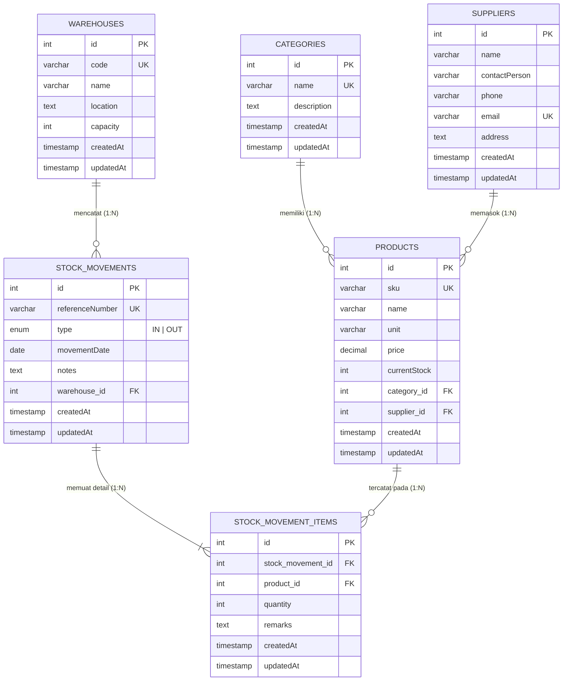

# 📦 Backend Sistem Pengelolaan Persediaan Barang (Inventory Management API)

Proyek ini disusun untuk memenuhi Ujian Tengah Semester (UTS) mata kuliah **Framework Programming**. Aplikasi ini merupakan RESTful API berbasis **NestJS** untuk mengelola data inventaris gudang, mencakup manajemen produk, kategori, pemasok, gudang penyimpanan, serta pencatatan transaksi keluar-masuk barang beserta perhitungan stok otomatis.

## 👥 Anggota Kelompok Capstone
* **[Intan Tri Hartati]** - [24090039]
* **[Muhammad Hammam Ghazi]** - [24090056]
* **[Muhammad Zaim El Yafi]** - [24090064]
* **[Muzaqi Nur Arifin]** - [24090132]

---

## 🛠️ Teknologi yang Digunakan
* **Framework:** NestJS (Node.js & TypeScript)
* **Database:** PostgreSQL 16 (Berjalan di atas Docker Container)
* **ORM:** TypeORM
* **Validasi Input & DTO:** `class-validator`, `class-transformer`, `@nestjs/mapped-types`
* **Validasi Environment:** `@nestjs/config` & `joi`
* **API Testing:** Postman

---

## 📂 Struktur Folder Proyek
Aplikasi ini menerapkan arsitektur modular sesuai standar NestJS, di mana setiap entitas memiliki `Module`, `Controller`, `Service`, `DTO`, dan `Entity` masing-masing:

```text
src/
├── categories/
│   ├── dto/
│   ├── entities/
│   ├── categories.controller.ts
│   ├── categories.module.ts
│   └── categories.service.ts
├── suppliers/
│   ├── dto/
│   ├── entities/
│   ├── suppliers.controller.ts
│   ├── suppliers.module.ts
│   └── suppliers.service.ts
├── warehouses/
│   ├── dto/
│   ├── entities/
│   ├── warehouses.controller.ts
│   ├── warehouses.module.ts
│   └── warehouses.service.ts
├── products/
│   ├── dto/
│   ├── entities/
│   ├── products.controller.ts
│   ├── products.module.ts
│   └── products.service.ts
├── stock-movements/
│   ├── dto/
│   ├── entities/
│   ├── stock-movements.controller.ts
│   ├── stock-movements.module.ts
│   └── stock-movements.service.ts
├── stock-movement-items/
│   ├── dto/
│   ├── entities/
│   ├── stock-movement-items.controller.ts
│   ├── stock-movement-items.module.ts
│   └── stock-movement-items.service.ts
├── app.module.ts
└── main.ts
```

---

## 🗄️ Desain Database & Entity Relationship Diagram (ERD)

### Visualisasi ERD


### Penjelasan Relasi Antartabel
1. **Categories -> Products (`1:N`):** Satu kategori dapat menaungi banyak produk, sedangkan satu produk terikat pada satu kategori.
2. **Suppliers -> Products (`1:N`):** Satu pemasok dapat menyuplai banyak produk.
3. **Warehouses -> StockMovements (`1:N`):** Satu gudang dapat memiliki banyak dokumen transaksi pergerakan stok.
4. **StockMovements -> StockMovementItems (`1:N`):** Satu transaksi pergerakan stok dapat memuat banyak baris item barang.
5. **Products -> StockMovementItems (`1:N`):** Satu produk dapat muncul di banyak detail transaksi pergerakan stok.

---

## ⚙️ Aturan Bisnis & Mekanisme Perhitungan Stok

1. **Inisialisasi Stok Awal:** Setiap produk baru yang didaftarkan melalui `POST /products` memiliki nilai stok awal (`currentStock = 0`).
2. **Transaksi Barang Masuk (`IN`):**
   * Saat item ditambahkan ke dalam transaksi bertipe `IN`, stok produk otomatis bertambah:
     $$\text{currentStock} = \text{currentStock} + \text{quantity}$$
3. **Transaksi Barang Keluar (`OUT`):**
   * Sistem memvalidasi ketersediaan stok sebelum menyimpan item transaksi `OUT`.
   * Apabila $\text{currentStock} < \text{quantity}$, sistem menolak transaksi dengan status **`400 Bad Request`** agar stok tidak bernilai negatif.
   * Apabila mencukupi, stok produk otomatis dikurangi:
     $$\text{currentStock} = \text{currentStock} - \text{quantity}$$
4. **Perubahan & Penghapusan Item Transaksi (`PATCH` & `DELETE`):**
   * Jika kuantitas item diubah atau dihapus, sistem melakukan *rollback* perhitungan terhadap `currentStock` produk terkait agar nilai stok selalu sinkron dengan riwayat transaksi.

---

## 🚀 Panduan Instalasi & Konfigurasi

### 1. Prasyarat Sistem
Pastikan perangkat telah terinstal:
* **Node.js** (v18 atau lebih baru)
* **Docker Desktop** (untuk menjalankan database PostgreSQL)
* **Postman** (untuk pengujian endpoint API)

### 2. Instalasi Dependensi
Clone repositori ini dan instal seluruh paket yang dibutuhkan:
```bash
npm install
```

### 3. Konfigurasi Environment (`.env`)
Buat file bernama **`.env`** di direktori utama (*root folder* sejajar dengan `package.json`), lalu isi dengan konfigurasi berikut:

```env
PORT=3000
DB_HOST=localhost
DB_PORT=5432
DB_USERNAME=postgres
DB_PASSWORD=mnurar245
DB_DATABASE=apifirstnestjs
```

### 4. Menjalankan Database PostgreSQL dengan Docker
Jalankan *container* database PostgreSQL di latar belakang menggunakan Docker Compose:
```bash
docker compose up -d
```

### 5. Menjalankan Aplikasi Backend NestJS
Jalankan server dalam mode *development (watch mode)*:
```bash
npm run start:dev
```
Aplikasi akan berjalan di **`http://localhost:3000`**. Tabel-tabel database akan otomatis dibuat oleh TypeORM (`synchronize: true`).

---

## 📡 API Specification

Base URL: `http://localhost:3000`

### 1. Modul Categories (`/categories`)
| Method | Endpoint | Deskripsi | Status Code |
| :--- | :--- | :--- | :--- |
| `POST` | `/categories` | Membuat kategori produk baru | `201 Created`, `409 Conflict` |
| `GET` | `/categories` | Menampilkan seluruh kategori beserta daftar produknya | `200 OK` |
| `GET` | `/categories/:id` | Menampilkan detail satu kategori berdasarkan ID | `200 OK`, `404 Not Found` |
| `PATCH` | `/categories/:id` | Memperbarui data kategori | `200 OK`, `404 Not Found` |
| `DELETE` | `/categories/:id` | Menghapus data kategori | `200 OK`, `404 Not Found` |

**Contoh Request Body (`POST /categories`):**
```json
{
  "name": "Elektronik & Perangkat",
  "description": "Komponen dan perangkat keras komputer"
}
```

---

### 2. Modul Suppliers (`/suppliers`)
| Method | Endpoint | Deskripsi | Status Code |
| :--- | :--- | :--- | :--- |
| `POST` | `/suppliers` | Mendaftarkan pemasok baru | `201 Created`, `409 Conflict` |
| `GET` | `/suppliers` | Menampilkan seluruh daftar pemasok | `200 OK` |
| `GET` | `/suppliers/:id` | Menampilkan detail pemasok berdasarkan ID | `200 OK`, `404 Not Found` |
| `PATCH` | `/suppliers/:id` | Memperbarui informasi pemasok | `200 OK`, `404 Not Found` |
| `DELETE` | `/suppliers/:id` | Menghapus data pemasok | `200 OK`, `404 Not Found` |

**Contoh Request Body (`POST /suppliers`):**
```json
{
  "name": "PT Sumber Teknologi Jaya",
  "contactPerson": "Budi Raharjo",
  "phone": "081234567890",
  "email": "sales@sumbertekno.co.id",
  "address": "Kawasan Industri Pulogadung, Jakarta"
}
```

---

### 3. Modul Warehouses (`/warehouses`)
| Method | Endpoint | Deskripsi | Status Code |
| :--- | :--- | :--- | :--- |
| `POST` | `/warehouses` | Membuat data gudang penyimpanan baru | `201 Created`, `409 Conflict` |
| `GET` | `/warehouses` | Menampilkan daftar seluruh gudang | `200 OK` |
| `GET` | `/warehouses/:id` | Menampilkan detail gudang beserta riwayat transaksinya | `200 OK`, `404 Not Found` |
| `PATCH` | `/warehouses/:id` | Memperbarui data gudang | `200 OK`, `404 Not Found` |
| `DELETE` | `/warehouses/:id` | Menghapus data gudang | `200 OK`, `404 Not Found` |

**Contoh Request Body (`POST /warehouses`):**
```json
{
  "code": "GDG-UTR-01",
  "name": "Gudang Utama Utara",
  "location": "Blok A No. 12",
  "capacity": 5000
}
```

---

### 4. Modul Products (`/products`)
| Method | Endpoint | Deskripsi | Status Code |
| :--- | :--- | :--- | :--- |
| `POST` | `/products` | Menambahkan produk baru (stok awal = 0) | `201 Created`, `404 Not Found`, `409 Conflict` |
| `GET` | `/products` | Menampilkan seluruh produk beserta kategori & pemasok | `200 OK` |
| `GET` | `/products/:id` | Menampilkan detail produk berdasarkan ID | `200 OK`, `404 Not Found` |
| `GET` | `/products/:id/stock-info` | **Fitur Khusus:** Menampilkan rekap stok (`totalIn`, `totalOut`, `currentStock`) & histori transaksi produk | `200 OK`, `404 Not Found` |
| `PATCH` | `/products/:id` | Memperbarui informasi produk | `200 OK`, `404 Not Found` |
| `DELETE` | `/products/:id` | Menghapus produk | `200 OK`, `404 Not Found` |

**Contoh Request Body (`POST /products`):**
```json
{
  "sku": "PRD-MCH-001",
  "name": "Mechanical Keyboard Wireless",
  "unit": "unit",
  "price": 750000,
  "categoryId": "550e8400-e29b-41d4-a716-446655440000",
  "supplierId": "550e8400-e29b-41d4-a716-446655440001"
}
```

---

### 5. Modul Stock Movements (`/stock-movements`)
| Method | Endpoint | Deskripsi | Status Code |
| :--- | :--- | :--- | :--- |
| `POST` | `/stock-movements` | Membuat dokumen transaksi pergerakan stok (`IN` / `OUT`) | `201 Created`, `409 Conflict` |
| `GET` | `/stock-movements` | Menampilkan semua transaksi (mendukung filter `?type=IN` atau `?type=OUT`) | `200 OK` |
| `GET` | `/stock-movements/:id` | Menampilkan detail transaksi beserta rincian item barangnya | `200 OK`, `404 Not Found` |
| `PATCH` | `/stock-movements/:id` | Memperbarui informasi dokumen transaksi | `200 OK`, `404 Not Found` |
| `DELETE` | `/stock-movements/:id` | Menghapus dokumen transaksi stok | `200 OK`, `404 Not Found` |

**Contoh Request Body (`POST /stock-movements`):**
```json
{
  "referenceNumber": "TRX-IN-20261101",
  "type": "IN",
  "movementDate": "2026-11-07",
  "warehouseId": "550e8400-e29b-41d4-a716-446655440002",
  "notes": "Pengadaan stok awal dari supplier"
}
```

---

### 6. Modul Stock Movement Items (`/stock-movement-items`)
| Method | Endpoint | Deskripsi | Status Code |
| :--- | :--- | :--- | :--- |
| `POST` | `/stock-movement-items` | Menambahkan item produk ke transaksi & memperbarui stok produk otomatis | `201 Created`, `400 Bad Request` |
| `GET` | `/stock-movement-items` | Menampilkan seluruh item detail transaksi | `200 OK` |
| `GET` | `/stock-movement-items/:id` | Menampilkan detail satu item transaksi | `200 OK`, `404 Not Found` |
| `PATCH` | `/stock-movement-items/:id` | Mengubah kuantitas/catatan item & menghitung ulang stok produk | `200 OK`, `400 Bad Request` |
| `DELETE` | `/stock-movement-items/:id` | Menghapus item dari transaksi & mengembalikan (*rollback*) stok produk | `200 OK`, `400 Bad Request` |

**Contoh Request Body (`POST /stock-movement-items`):**
```json
{
  "stockMovementId": "550e8400-e29b-41d4-a716-446655440003",
  "productId": "550e8400-e29b-41d4-a716-446655440004",
  "quantity": 50,
  "remarks": "Kondisi segel baik"
}
```

---

## 🧪 Urutan Skenario Pengujian di Postman

Untuk mendemonstrasikan aplikasi secara menyeluruh, jalankan *request* pada Postman dengan urutan berikut:
1. **`POST /categories`** — Buat data kategori terlebih dahulu.
2. **`POST /suppliers`** — Buat data pemasok barang.
3. **`POST /warehouses`** — Buat data gudang penyimpanan.
4. **`POST /products`** — Buat produk baru dengan menghubungkan `categoryId` dan `supplierId`.
5. **`POST /stock-movements`** — Buat transaksi masuk dengan `"type": "IN"`.
6. **`POST /stock-movement-items`** — Masukkan produk beserta kuantitas barang masuk (misal: `50`).
7. **`POST /stock-movements`** — Buat transaksi keluar dengan `"type": "OUT"`.
8. **`POST /stock-movement-items`** — Masukkan produk beserta kuantitas barang keluar (misal: `15`).
9. **`GET /products/:id/stock-info`** — Ganti `:id` dengan UUID produk, lalu periksa hasil perhitungan stok (`totalIn: 50`, `totalOut: 15`, `currentStock: 35`).
10. **Uji Validasi Error (`400 Bad Request`):** Coba kirim `POST /stock-movement-items` pada transaksi `OUT` dengan `quantity: 100` (melebihi sisa stok `35`) untuk membuktikan sistem menolak stok minus.